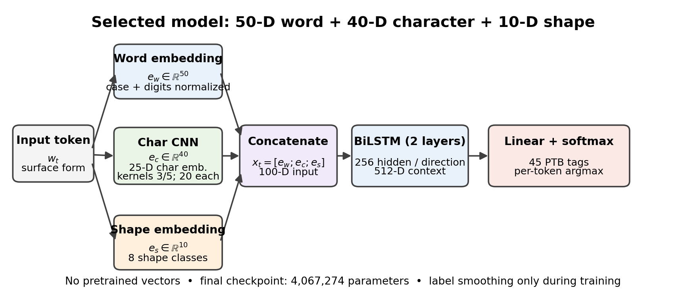

# DAL-585 PA2 — Neural POS Tagger

A PyTorch POS tagger for the DAL-585 Programming Assignment 2. It learns all representations from the provided training corpus (no pretrained word vectors) and keeps each token's concatenated input representation at 100 dimensions or fewer.

**Authors:** Yash Gupta (23118081) and Adarsh Maurya (23125004).

## Architecture



The selected run uses a 50-D lexical embedding, a 40-D character-CNN representation, and a 10-D orthographic-shape embedding. The 100-D token input is encoded by a two-layer BiLSTM (256 hidden units per direction) and mapped to one of 45 POS labels with a token-level softmax. The editable Draw.io diagram is available at [`report/drawio/pos_tagger_architecture.drawio`](report/drawio/pos_tagger_architecture.drawio).

## Measured result

| Metric | Result |
|---|---:|
| Development token accuracy | **97.739%** (46,556/47,633) |
| Exact-sentence accuracy | 60.863% (1,213/1,993) |
| Exact-surface OOV accuracy | 89.803% (1,092/1,216) |
| Best internal validation accuracy | 97.585% (single seed, seed 42) |
| Trainable parameters | 4,067,274 |

This is accuracy on the supplied development set, not the blind test set. The complete run tested 23 variants with one seed; close rankings are not statistically conclusive. Results, history, configuration, confusion pairs, per-tag metrics, predictions, and figures are retained under [`results/`](results/). Model checkpoints and course data files are intentionally not tracked in public Git history.

### HMM baseline

Yash's PA1 report records 96.4122% development accuracy, 96.74% known-token accuracy, 83.88% OOV accuracy, 4.944 s build time, and 2.125 s inference time. Adarsh's independent HMM result is pending. The HMM prediction file was not supplied, so the current report compares aggregate metrics only.

## Report

- [Editable ACL-style report source](report/main.tex)
- [Report bibliography](report/references.bib)
- [Architecture diagram](report/figures/architecture.png)
- [Evaluation protocol diagram](docs/figures/evaluation_protocol.png)
- [Report compile instructions](report/README.md)

**Final report link:** add the shared Google Drive URL here once the PDF is uploaded; no Drive link has been supplied yet. The report source is provided here for editing. Compile it in the official ACL Overleaf template and verify the resulting PDF is 4–6 pages before printing.

## Run

From the repository root, with Python 3.10 and a compatible PyTorch installation:

```bash
python build_tagger.py data/train.tags
python run_tagger.py data/dev.sents dev.out
python MeasurePOSTaggerAccuracy.py dev.out data/dev.tags
```

To reproduce the ablation suite, model selection, full-data refit, development evaluation, figures, and tables:

```bash
python run_all.py --profile full --device cuda
```

Basic checks:

```bash
python tests/data_contract_test.py
python tests/stress_test.py --data-dir data --max-sentences 60 --epochs 1 --device cpu
```

The stress test checks software behavior only; its small-data accuracy must not be reported as model performance. See [`docs/QA_RESULTS.md`](docs/QA_RESULTS.md) for the test scope.

## Repository hygiene

The `.gitignore` excludes Python environments/caches, model checkpoints, the PA2 handout, and supplied course data files. It deliberately does **not** ignore `results/`, so the measured experiment tables, JSON metrics, prediction diagnostics, and figures can be tracked. Note that `gitignore` does not untrack files that are already in Git history; if a checkpoint or course dataset was committed previously, use the cleanup commands in `report/README.md`. Confirm the course policy before publicly sharing data or handouts.


## Apply the update patch from WSL2

Extract `POS_Tagger_PA2_GitHub_Update_Patch.zip` over the existing project root (the ZIP is flat-root). Then inspect the diff before committing:

```bash
unzip -o /path/to/POS_Tagger_PA2_GitHub_Update_Patch.zip -d .
python tests/data_contract_test.py
python tests/stress_test.py --data-dir data --max-sentences 60 --epochs 1 --device cuda
git status --short
```

The `.gitignore` cannot untrack files already committed. Before committing, inspect `git ls-files | grep -E '(^|/)(tagger_model\.pt|.*\.(pt|pth)|train\.tags|dev\.tags|dev\.sents|PA2\.pdf)$'`. If prohibited course data or a checkpoint is already tracked, remove only that path from the index with `git rm --cached <path>` (keeps the local file), then commit. Do not add `.venv/`, any `*.pt`/`*.pth`, or course data. The measured `results/` tables/figures should remain tracked.

```bash
git add .gitignore README.md docs/figures report results
git status --short
git commit -m "Finalize PA2 report assets and publish experiment results"
git push origin main
```
